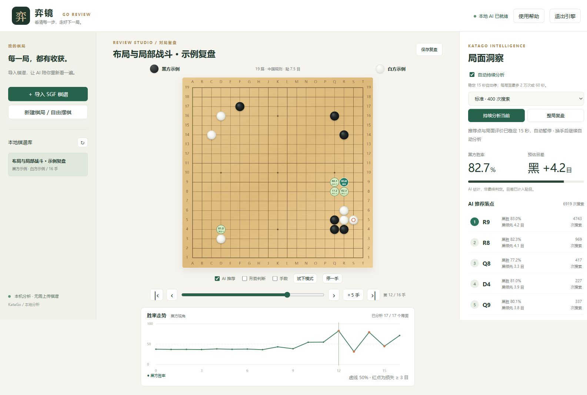

# 弈镜 · Yijing Go Review

一个中文、轻量的 **KataGo 本地围棋复盘工具**。浏览器显示棋盘，Python 服务调用电脑上的 KataGo；配置完成后，日常复盘无需上传棋谱或连接云端分析服务。



*使用内置示例棋局截取，展示真实本机 KataGo 分析结果。*

目前是早期可用版本，优先打磨日常复盘流程。不是星阵官方产品，也不以替代成熟 SGF 编辑器为目标。

## 功能

- 导入 SGF 后自动复盘整局，显示黑方胜率曲线、预估目差和关键失误。
- 浏览棋谱或试下落子后，自动分析当前局面，实时显示候选点与 AI 变化。
- 稳定后暂停：至少 2,000 次搜索，首选点连续 15 秒不变，胜率波动不超过 0.5 个百分点、目差波动不超过 0.3 目。
- 每个持续分析任务另有 **20,000 次搜索或 60 秒**上限，换手后继续分析。
- 试下结束后返回进入试下前的原谱位置；支持变化预览、前进 5 手、停一手。
- 兼容 9 / 13 / 19 路、让子、中文编码，以及野狐 SGF 的特殊贴目值。
- 普通棋盘 / **3D 形势**切换：半透明黑白归属地形，支持旋转、缩放与平移；换手、试下和分析结果自动同步，边缘平滑收坡。
- **Lizzie / LizzieYzy 联动扩展**：与原 GUI 共用 KataGo，在独立浏览器窗口显示 3D 形势；提供可恢复的 LizzieYzy 配置安装器。
- 本地棋谱库，保留复盘结果；旧页面保存时保留同一棋局更完整的分析。

## 快速开始：Windows x64

准备 Python **3.11 或以上**、Git，以及可正常使用 OpenCL 的显卡驱动。首次安装需联网下载引擎与约 94 MB 的模型。

```powershell
git clone https://github.com/dengtingyu/yijing-go-review.git
cd yijing-go-review
python -m venv .venv
.\.venv\Scripts\python.exe -m pip install -r requirements.txt
.\.venv\Scripts\python.exe setup_engine.py
.\.venv\Scripts\python.exe launch.pyw
```

浏览器打开 **http://127.0.0.1:18765**。也可以直接运行 `python server.py` 后手动打开该地址。

安装脚本从官方来源下载 **KataGo 1.18.1 OpenCL Windows x64** 和 **b18c384nbt-s9996604416-d4316597426** 模型，验证 SHA256 后安装。它不会覆盖已有的 `engine/local.cfg`。首次启动可能进行显卡调优，需要等待几分钟。

下载遇到问题，可从 [KataGo 官方发行页](https://github.com/lightvector/KataGo/releases/tag/v1.18.1) 与 [官方模型列表](https://katagotraining.org/networks/) 下载上述固定版本，再运行：

```powershell
python setup_engine.py --engine-zip "C:\Downloads\katago-v1.18.1-opencl-windows-x64.zip" --model-file "C:\Downloads\kata1-b18c384nbt-s9996604416-d4316597426.bin.gz"
```

## 日常复盘

1. 导入或拖入 SGF；也可先点击「打开示例棋局」。
2. 等待整局分析，点击曲线、滑条、失误列表或使用左右键查看局面。
3. 点击「试下模式」，尝试自己的下法；点「结束试下」或「返回原谱」回到进入前的位置。
4. 点击 AI 候选点预览变化，用左右键逐步查看，或点「＋5 手」。
5. 自动分析会在稳定或达到上限时暂停。点击「停止」会关闭自动模式；重新勾选「自动持续分析」即可继续。
6. 棋盘上方切换「3D 形势」，拖动旋转、滚轮缩放、右键平移。没有当前局面的分析时只显示棋盘，AI 变化预览也不会套用原局面地形。

3D 高度是 AI 对最终归属的倾向强度，不是胜率或传统外势。空间平滑和边缘收坡用于展示，原始分析数据不变。Three.js 已放在项目中，日常使用不需要联网加载图形库。

100 / 400 / 1600 是整局复盘每个局面的搜索次数预设，并非棋力等级，也未针对所有硬件优化。自动分析采用上述稳定条件和上限。稳定判断只是计算资源控制的启发式，不能证明推荐点正确；关键失误由相邻局面目差变化估算。

关闭网页后，本地服务仍可能运行。右上角「退出引擎」保存原谱并结束服务。

## 给 Lizzie 加上 3D 形势

联动扩展现已独立为 **[Lizzie Terrain](https://github.com/dengtingyu/lizzie-terrain)**，提供真实截图、独立安装器和测试。后续安装与更新推荐使用独立仓库。

这是 GTP 外接式联动扩展，使用原来的 KataGo 进程，无需修改 Lizzie 源码。当前仓库也保留初版入口，先关闭 LizzieYzy，再运行：

```powershell
python install_lizzie_terrain.py "C:\LizzieYzy\config.txt" --default
```

重开后使用「KataGo · 3D 形势」引擎，浏览器会自动打开联动窗口。原引擎条目保留，配置另有备份。原版 Lizzie 可手动把同一扩展加在引擎命令前；配置方式、兼容范围与恢复方法见 [联动扩展说明](docs/lizzie-terrain.md)。

## 自定义引擎与模型

默认查找 `engine/katago.exe`、`engine/model.bin.gz` 与 `engine/local.cfg`。可以编辑配置文件，或设置环境变量：

```powershell
$env:KATAGO_PATH = "C:\KataGo\katago.exe"
$env:KATAGO_MODEL = "C:\KataGo\model.bin.gz"
$env:KATAGO_CONFIG = "C:\KataGo\analysis.cfg"
$env:YIJING_PORT = "18765"
python launch.pyw
```

`configs/analysis.cfg` 是通用起点，默认由 KataGo 选择设备。多显卡或其他后端需按 KataGo 文档调整；自动下载安装目前仅支持 Windows x64 OpenCL。其他平台可自行安装匹配的 KataGo、模型和配置，并通过上述环境变量接入，尚未完成界面和引擎的跨平台验证。

## 数据与目录

```text
server.py                  本地服务、SGF 解析与 KataGo 通信
web/                       中文浏览器界面
launch.pyw                 启动服务并打开浏览器
setup_engine.py            官方引擎与模型下载、校验
configs/analysis.cfg       分析配置模板
engine/                    本机下载的引擎、模型与调优缓存（Git 忽略）
library/                   本机棋谱及复盘结果（Git 忽略）
backups/                   旧格式迁移备份（Git 忽略）
```

原始导入 SGF 会保存在棋谱库记录中，备份 `library/` 即可保留棋谱和结果。服务只监听回环地址，设计用于个人本机使用。

## 开发与检查

```powershell
python -m unittest test_review test_lizzie_terrain -v
node --check web/app.js
node test_auto_analysis.cjs
node test_terrain.cjs
python setup_engine.py --verify-only
```

Python 单元测试和 Node 状态回归测试不需要模型或显卡。`--verify-only` 需要已下载的固定引擎 ZIP 和模型。可选真实服务检查：先启动已配置好的服务，再设置 `YIJING_INTEGRATION=1` 运行 Python 测试。

## 当前限制

读取 SGF 主线；暂不支持中途摆子、完整分支编辑、导出所有变化、联网对弈、自然语言棋理讲解。新建棋局支持交替落子、提子、禁入点和劫争检查；已知部分特殊规则仍按中国／日本规则近似处理。

欢迎提交可复现的问题。附棋谱前请先确认可以公开分享。

## 许可证与致谢

界面与服务代码采用 [MIT](LICENSE) 许可证。KataGo、模型和 sgfmill 适用各自许可，详见 [第三方说明](THIRD_PARTY_NOTICES.md)。引擎、模型权重及个人棋谱不包含在仓库中。

感谢 [KataGo](https://github.com/lightvector/KataGo) 与 [sgfmill](https://mjw.woodcraft.me.uk/sgfmill/)。也推荐了解 [LizzieYzy](https://github.com/yzyray/lizzieyzy)、[KaTrain](https://github.com/sanderland/katrain) 和 [Ogatak](https://github.com/rooklift/ogatak) 等成熟项目。
